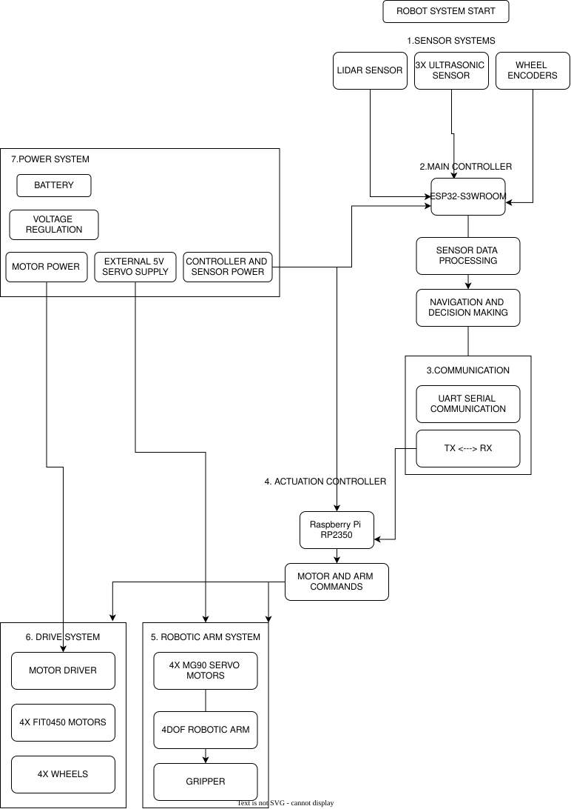

# Multi-functional-robot-car
This robot car includes three functions. That is, line-following, recognizing obstacles, and controlling the robotic arm for removing the obstacles on path. We will try to build our own 3D printed robotic arm which is included gripper. When this robot car is activated, it starts to move forward on the black line. Going forward in this way, the ultrasonic sensor calculates the distance ahead. In this case, when there is an obstacle in front of, the robot stops. Then, the obstacle is removed using the robotic arm. After, the robot will move forward freely again.

Team Members: Vitalii Nazarenko, Abdulah Köse  
Technical Collaborator: Khoa Dang

The readme file will be updated as developments occur...

## Documentation
- **[Mecanum Drivetrain Developer Guide (English)](./DRIVETRAIN_GUIDE.md)** — Complete API reference, coordinate conventions, PID control explanation, and code examples for controlling the Mecanum robot car.

